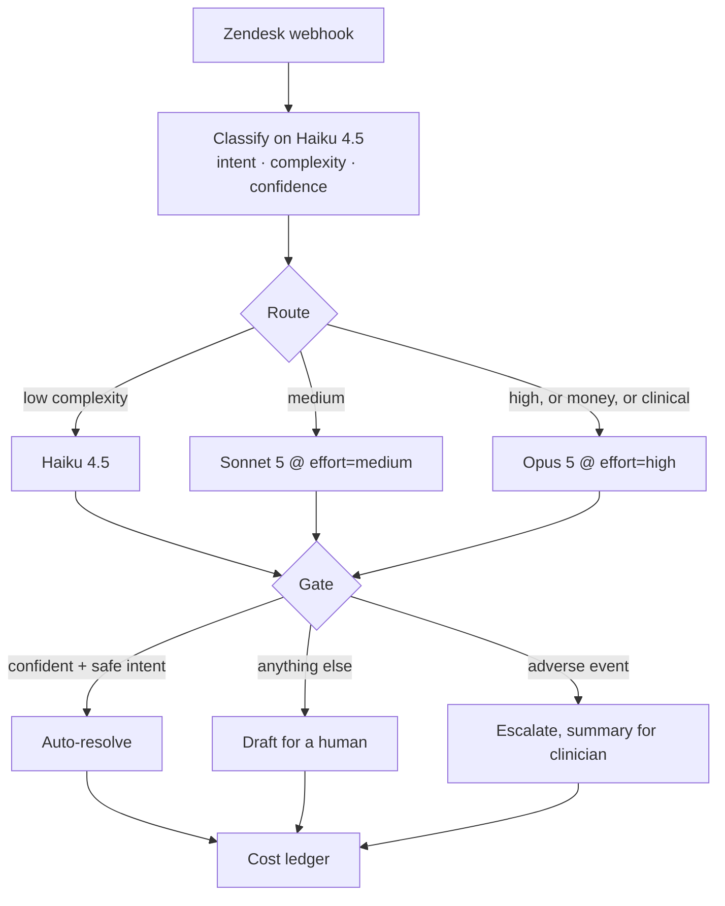

# AI Triage Router

A support-triage automation that classifies an inbound ticket, routes the reply to the cheapest model that can handle it, gates anything risky to a human, and accounts for every token it spends.

It runs end to end with **no API key and no network** — the model calls have deterministic local stand-ins, so you can clone it and see the routing, the gating, the evals, and the cost ledger immediately.

```
git clone <this repo> && cd ai-triage-router
node scripts/demo.js      # walk 7 tickets through the pipeline
node --test evals/        # policy guard tests
node evals/run.js         # scored eval vs labeled tickets, fails on regression
```

No `npm install` needed for any of the above.

## Why this shape

Most "AI for support" builds send every ticket to the best available model and hope the prompt holds. That is expensive on the easy tickets and unsafe on the hard ones. This splits the problem:



Classification is a short, constrained task, so it always runs on the cheap tier. Only the *draft* is routed by difficulty. On the sample set that is **46.8% cheaper per ticket** than sending everything to the frontier model, measured rather than claimed — the ledger prices the same token counts both ways.

## The gate is the point

Two things are never auto-resolved no matter how confident the classifier is: money and medicine. That rule lives in [`src/policy.js`](src/policy.js) in plain language, and it is enforced in [`src/router.js`](src/router.js) — a pure function with no I/O, so the policy can be tested independently of the model.

That independence matters. An earlier version of this repo had the safety rules in the policy *and* a classifier that already refused to auto-resolve clinical tickets. Weakening the policy to nothing changed no eval metric — the rules looked protective but were dead code. [`evals/policy.test.js`](evals/policy.test.js) now drives `route()` with classifications a real model should never emit (`intent: clinical_question, confidence: 0.99, autoResolvable: true`) and asserts the policy still refuses. Deleting the safety rules now fails 3 tests.

## Evals

`evals/run.js` scores the pipeline against 29 labeled tickets and compares to a committed baseline:

| metric | meaning |
| --- | --- |
| intent accuracy | predicted intent vs label |
| auto-resolve precision | of tickets we closed without a human, how many should have been |
| auto-resolve recall | of tickets that *could* be closed, how many we caught |
| escalation recall | of clinically sensitive tickets, how many stayed away from an auto-reply |
| cost / ticket | vs the all-frontier baseline |

A drop beyond tolerance exits non-zero. **Any** sensitive ticket that gets auto-resolved is an immediate hard failure, not a tolerance check. Record a new baseline with `node evals/run.js --update-baseline`.

Current numbers on the sample set:

```
intent accuracy        93.1%
auto-resolve rate      41.4%
auto-resolve precision 100.0%
escalation recall      100.0%
cost / ticket          $0.0054  vs $0.0102 all-frontier  (46.8% saved)
```

Intent accuracy is not 100% on purpose. Ticket `T-1029` describes a side effect without using any side-effect vocabulary, and the keyword classifier misses it — but it falls below the confidence gate and still reaches a human. That is the behavior you want from the gate, and hiding it behind a tuned fixture set would make the eval decorative.

## Running it live

```bash
npm install                       # pulls @anthropic-ai/sdk
export ANTHROPIC_API_KEY=sk-ant-...
MODE=live node scripts/demo.js
MODE=live node evals/run.js
```

Live mode uses the official Anthropic SDK. Classification uses structured outputs (`output_config.format` with a JSON schema) so the label comes back validated instead of parsed out of prose. Token counts come from real `usage`, so the cost ledger reports actual spend rather than an estimate.

## As a webhook

```bash
node src/server.js
curl -X POST localhost:8787/webhook \
  -H 'content-type: application/json' \
  -d @fixtures/zendesk-sample.json
```

```json
{
  "ticket_id": "90210",
  "action": "escalate",
  "model": "claude-opus-5",
  "intent": "side_effect_report",
  "confidence": 0.93,
  "reasons": [
    "complexity=high -> claude-opus-5",
    "intent=side_effect_report escalates to a human immediately"
  ],
  "cost_usd": 0.010724
}
```

[`src/worker.js`](src/worker.js) is the same handler as a Cloudflare Worker (`wrangler deploy`), with a shared-secret check so the endpoint cannot be used to burn your token budget.

## Layout

| path | what it is |
| --- | --- |
| `src/policy.js` | every routing and safety rule, in one readable file |
| `src/router.js` | pure routing decision — no I/O, fully testable |
| `src/models.js` | model registry and per-MTok pricing |
| `src/cost.js` | spend ledger and the all-frontier comparison |
| `src/providers/mock.js` | deterministic local stand-ins |
| `src/providers/anthropic.js` | live SDK calls, structured outputs |
| `src/handler.js` | transport-agnostic entry point |
| `evals/` | policy guard tests + scored eval + baseline |
| `fixtures/` | 29 labeled tickets |

## Caveats

- The mock classifier is keyword rules, not a model. It exists so the pipeline is runnable and the evals are deterministic — it is not a claim about classification quality.
- Prices in `src/models.js` are Anthropic first-party rates at time of writing. Verify before budgeting against them.
- The sample tickets are synthetic and written for this demo.
